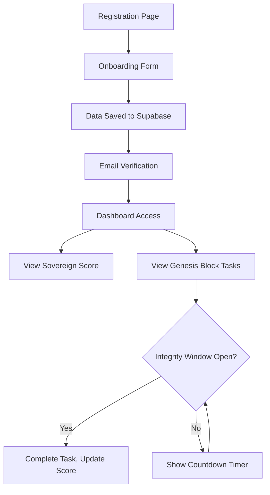

## 1. Product Overview
Gan Network is a sovereign goal-tracking platform that enforces integrity through cryptographic proof and timed task completion windows. It transforms the original GoalAI system by implementing the Genesis Protocol to fix onboarding failures and transition to the Gan-Lang architecture.

The platform serves users seeking structured goal achievement with built-in integrity mechanisms, providing a transparent and accountable system for personal and professional growth tracking.

## 2. Core Features

### 2.1 User Roles
| Role | Registration Method | Core Permissions |
|------|---------------------|------------------|
| Registered User | Email registration & verification | Can complete tasks, view trust score, access dashboard features |
| System | Automated | Manages integrity hashing, trust score calculations, and system enforcement |

### 2.2 Feature Module
Our Gan Network requirements consist of the following main pages:
1. **Onboarding Page**: User registration form, skill selection, profile creation with "Finish" button that redirects to dashboard.
2. **Dashboard Page**: Sovereign Score widget, task list with countdown timers, Genesis Block initial tasks display.
3. **Login Page**: User authentication, email verification flow.

### 2.3 Page Details
| Page Name | Module Name | Feature description |
|-----------|-------------|---------------------|
| Onboarding Page | User Registration Form | Collect full_name, north_star, value_skill during sign-up. Save all data including "sales" skill to Supabase. Fix Zod validation to allow all valid skill types. |
| Onboarding Page | Finish Button Logic | After successful profile creation, redirect user to /dashboard. Ensure no "Unable to Save" errors occur during submission. |
| Dashboard Page | Sovereign Widget | Display user's trust_score from Supabase as "Sovereign Score" at the top of the dashboard. Update visual branding with Gan Network identity. |
| Dashboard Page | Task Cards | Show initial "Genesis Block" tasks for new users. Implement countdown timer when server returns 429 (Too Fast) error, displaying time remaining until Integrity Window opens. |
| Login Page | Email Verification | Complete email verification flow before granting dashboard access. Integrate with Supabase auth system. |
| System-wide | Integrity Hashing | Generate SHA-256 integrity_hash on successful registration and task completion. Store hash in gan_users table for Proof of Integrity. |

## 3. Core Process
Main user operation flow:
1. User visits registration page and creates account with email/password
2. User completes onboarding form with personal details and skill selection
3. System generates integrity_hash and saves all data to Supabase
4. User verifies email through verification link
5. User is redirected to dashboard where they see their Sovereign Score and Genesis Block tasks
6. When attempting task completion, if Integrity Window is not open, system shows 429 error with countdown timer
7. Upon successful task completion, system updates trust_score and generates new integrity_hash

## 4. User Interface Design
### 4.1 Design Style
- Primary colors: Deep navy (#1a1a2e) as base, gold (#f4d03f) for trust score highlights, slate gray for backgrounds
- Button style: Rounded corners (8px), subtle hover effects, primary action buttons in accent color
- Font: Inter font family, 16px base size, 24px for Sovereign Score, 18px for section headers
- Layout style: Card-based dashboard, top navigation with Gan Network branding, responsive grid layout
- Icon style: Minimal line icons, blockchain/cryptography themed icons for integrity features, clock icon for countdown timers

### 4.2 Page Design Overview
| Page Name | Module Name | UI Elements |
|-----------|-------------|-------------|
| Onboarding Page | Registration Form | Clean form layout with floating labels, skill selection dropdown that includes "sales" option, full-width "Finish" button with loading state |
| Dashboard Page | Sovereign Widget | Top card with large "Sovereign Score: X" display, gold accent bar, animated number counter when loading, Gan Network logo in header |
| Dashboard Page | Task Cards | Genesis Block tasks labeled with "Genesis" badge, countdown timer overlay in red when 429 received, complete button that submits task completion |
| All Pages | Notifications | Custom Banner/Toast components replacing console.error for user-friendly error messages, success notifications for profile saves and task completions |

### 4.3 Responsiveness
Desktop-first design with mobile adaptive layouts. Touch interactions optimized for mobile users, including countdown timer touch-to-refresh and task card swipe actions.

### 4.4 Technical Implementation Notes
- All "GoalAI" references replaced with "Gan Network" across all UI text and branding elements
- Custom Toast/Banner components implement all user notifications, eliminating console.error calls that trigger Next.js dev overlay
- Prisma schema synchronized with Supabase database through `npx prisma db push`
- Codebase passes `npm run lint` with no errors ensuring build stability