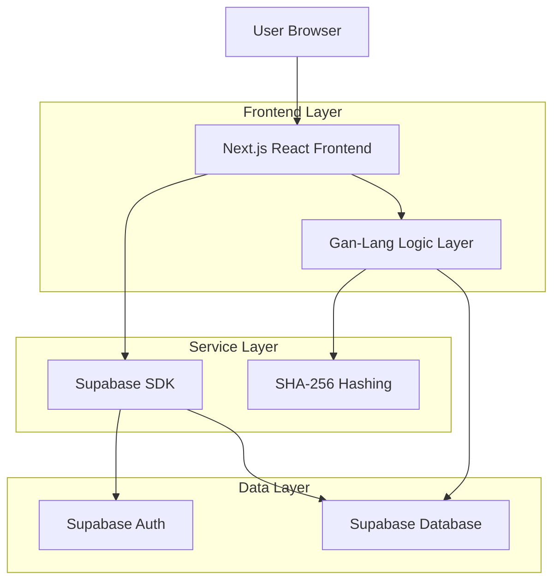
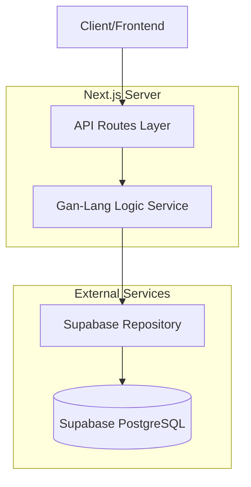
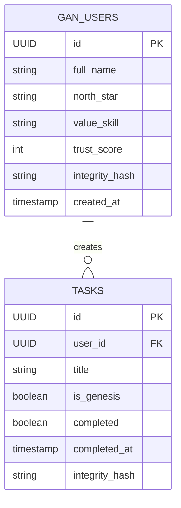

## 1. Architecture Design



## 2. Technology Description

* Frontend: Next.js + React\@18 + TypeScript + TailwindCSS\@3

* Initialization Tool: Vite (for compatible modules)

* Backend: Supabase (Auth + Database)

* ORM: Prisma (for database management)

* Cryptography: Node.js crypto module for SHA-256 hashing

## 3. Route Definitions

| Route       | Purpose                                                  |
| ----------- | -------------------------------------------------------- |
| /           | Landing page with Gan Network branding                   |
| /login      | User authentication page                                 |
| /signup     | New user registration                                    |
| /onboarding | Profile completion form with skill selection             |
| /dashboard  | Main dashboard with Sovereign Score widget and task list |

## 4. API Definitions

### 4.1 Core User API

POST /api/user - Create or update user profile

**Request:**

| Param Name   | Param Type | isRequired | Description                              |
| ------------ | ---------- | ---------- | ---------------------------------------- |
| full\_name   | string     | true       | User's full name                         |
| north\_star  | string     | true       | User's primary goal/north star metric    |
| value\_skill | string     | true       | User's primary skill (including "sales") |

**Response:**

| Param Name | Param Type | Description                                |
| ---------- | ---------- | ------------------------------------------ |
| success    | boolean    | Operation status                           |
| redirect   | string     | URL to redirect to on success (/dashboard) |
| error      | string     | Error message if operation failed          |

### 4.2 Task Completion API

POST /api/tasks/\[id]/complete - Mark task as completed

**Response Codes:**

* 200: Task completed successfully

* 429: Too Fast - Integrity Window not open, returns retry\_after in seconds

## 5. Server Architecture Diagram



## 6. Data Model

### 6.1 Data Model Definition



### 6.2 Data Definition Language (Supabase SQL)

**gan\_users table creation:**

```sql
-- Create gan_users table
CREATE TABLE gan_users (
    id UUID PRIMARY KEY DEFAULT gen_random_uuid(),
    full_name VARCHAR(255) NOT NULL,
    north_star TEXT,
    value_skill VARCHAR(100),
    trust_score INTEGER DEFAULT 500 NOT NULL,
    integrity_hash VARCHAR(64) NOT NULL,
    created_at TIMESTAMP WITH TIME ZONE DEFAULT NOW()
);

-- Enable Row Level Security
ALTER TABLE gan_users ENABLE ROW LEVEL SECURITY;

-- Grant permissions
GRANT SELECT ON gan_users TO anon;
GRANT ALL ON gan_users TO authenticated;

-- Create policies
CREATE POLICY "Users can view own data" ON gan_users 
    FOR SELECT USING (auth.uid() = id);
    
CREATE POLICY "Users can update own data" ON gan_users 
    FOR UPDATE USING (auth.uid() = id);
```

**Prisma Schema snippet (schema.prisma):**

```prisma
model GanUser {
    id            String    @id @default(uuid())
    fullName      String    @db.VarChar(255)
    northStar     String?
    valueSkill    String?   @db.VarChar(100)
    trustScore    Int       @default(500)
    integrityHash String    @db.VarChar(64)
    createdAt     DateTime  @default(now()) @map(name: "created_at")
}
```

### 6.3 src/lib/gan-logic.ts Implementation

Centralized integrity logic handler:

```typescript
import { createHash } from 'crypto';

export class GanLogic {
    // Generate SHA-256 integrity hash
    static generateIntegrityHash(data: object): string {
        const dataString = JSON.stringify(data) + process.env.INTEGRITY_SECRET;
        return createHash('sha256').update(dataString).digest('hex');
    }
    
    // Enforce Integrity Interval (minimum time between task completions)
    static canCompleteTask(lastCompletedAt: Date): { allowed: boolean; retryAfter: number } {
        const INTEGRITY_WINDOW = 3600; // 1 hour in seconds
        const now = new Date();
        const diff = now.getTime() - lastCompletedAt.getTime();
        const secondsSinceLast = diff / 1000;
        
        if (secondsSinceLast < INTEGRITY_WINDOW) {
            return {
                allowed: false,
                retryAfter: Math.ceil(INTEGRITY_WINDOW - secondsSinceLast)
            };
        }
        
        return { allowed: true, retryAfter: 0 };
    }
}
```

### 6.4 Fix for POST /api/user route (Zod validation fix)

**Original issue:** Zod schema restricted value\_skill to specific enum values excluding "sales"
**Fixed Zod schema:**

```typescript
// Updated Zod validation in API route
const userSchema = z.object({
    full_name: z.string().min(2),
    north_star: z.string(),
    value_skill: z.string() // Removed enum restriction to allow "sales" and all skills
});
```

### 6.5 Dashboard page.tsx handleComplete modification

```typescript
async function handleComplete(taskId: string) {
    try {
        const response = await fetch(`/api/tasks/${taskId}/complete`, { method: 'POST' });
        
        if (response.status === 429) {
            const data = await response.json();
            setTaskCountdown(taskId, data.retry_after); // Start countdown timer
            toast.show(`Integrity Window closed. Retry in ${formatTime(data.retry_after)}`);
        } else if (response.ok) {
            toast.success("Task completed! Your Sovereign Score has increased.");
            refreshDashboard();
        }
    } catch (error) {
        banner.show("An error occurred. Please try again.");
    }
}
```

## 7. Deployment & Verification Steps

1. Run `npx prisma db push` to sync Prisma schema with Supabase
2. Verify all console.error calls replaced with Banner/Toast components
3. Execute `npm run lint` to ensure code quality
4. Test full flow: signup → email verify → onboarding save → dashboard access with Genesis Block tasks

